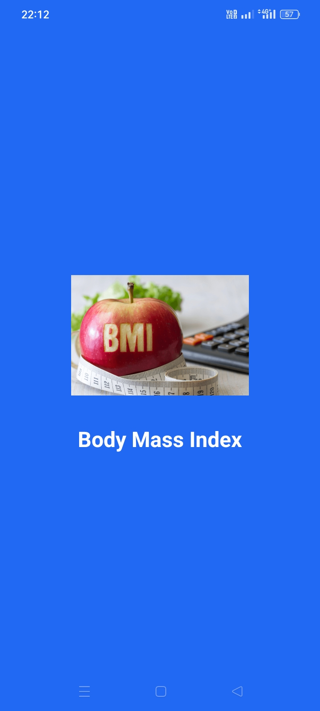
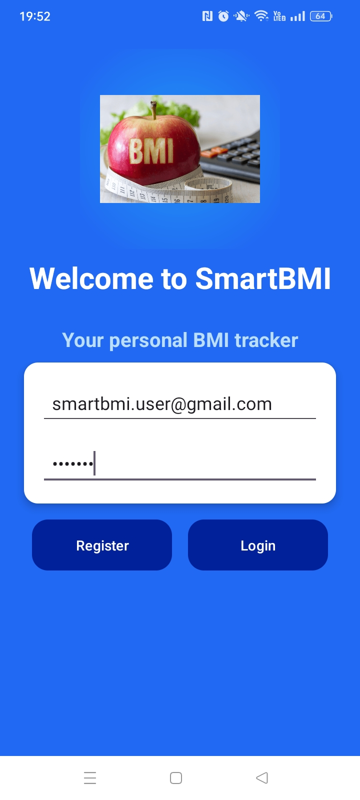
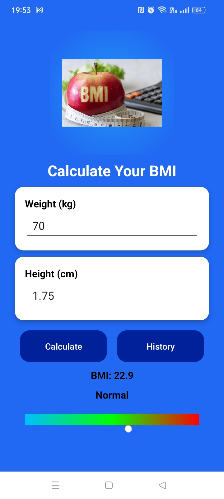
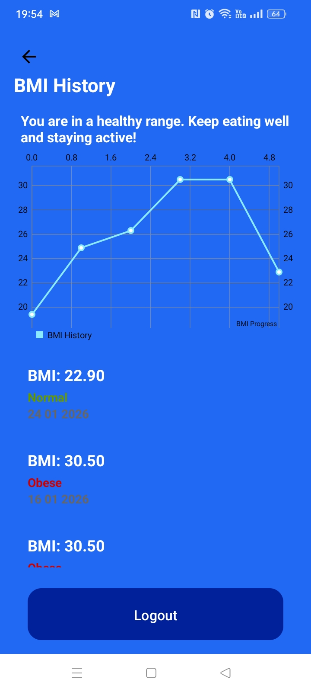

# 🏃‍♀️ 💪 SmartBMI - Your Personal BMI Tracker

SmartBMI is an Android application that helps users calculate their Body Mass Index(BMI), understand their health status, and track BMI history over time. The app focuses on clean UI, accessibility, and proper data storage using modern Android development practices.🌟

---

## ✨ Features

- 🖼️ **Splash Screen**
    - With logo & full app name
- 👋 **Welcome Screen**
    - **Firebase Authentication**
        - Register and login using email and password
        - Secure user authentication
- ⚖️ **BMI Calculator**
    - Calculate BMI using weight and height
    - Formular: BMI = weight / (height * height)
    - **Colors & Categories**
        - 🟦 Underweight
        - 🟩 Normal
        - 🟧 Overweight
        - 🟥 Obese
- **Save BMI Records**
    - Save BMI results locally using **Room Database**
    - Save BMI result to **Firebase** for cloud backup
- **BMI Result Display**
    - Displays calculated BMI value
    - Displays BMI health category
- 🌈 **Visual BMI Ruler**
    - Color-coded ruler showing BMI ranges
    - Moving indicator that positions itself based on BMI result
- 🗣️ **Text-to-Speech**
    - Provides audio feedback for BMI result and health category
    - Improves accessibility and user experience
- **History Screen**
- 🔙 **Back arrow navigation**
    - Custom back arrow at the top of the screen for easy navigation, if user you want calculate BMI again
- **Health Message**
    - Shows a health message based on the most recent BMI calculation
- **BMI History Chart**
    - Track user's BMI history visually to monitor user's progress
- View saved BMI records with calculation dates
- Displayed using CardView for a clean UI
- **Logout**
    - Secure logout using Firebase Authentication

---

## 📷 Screenshots
#### Splash Screen

#### Welcome Screen

#### BMI Calculation Screen

#### BMI History Screen

---

## 🚀 Installation

1. **Clone** this repository: '''bash
   git clone
   https:/github.com/RapolaiKate/SmartBMI.git
2. open the project in Android Studio
3. Sync Gradle and build the project
4. Run the app on an emulator or physical device

---

## 📝 Usage

1. open the app 🟢
2. Register or log in using email and password
3. Enter your weight and height
4. Tap Calculate ✅
5. View your BMI result, category, and ruler color with indicator
6. Listen to your BMI reading 🎤
7. Go to history and see the records

---

## ⚒️ Technologies

. 🖤 **Language**: Kotlin
.    **Architecture**: MVVM
.    **Database**: Room
.    **Authentication & Cloud**: Firebase, Authentication, Firebase Database
. 🎨 **UI Components**: Activities, CardView, LinearLayout, ImamageButton
. 🗣️ **Accessibility**: Android Text-To-Speech

---

Why this project?

This project demonstrates my ability to build a complete Android application using modern development practices. It includes user authentication, local and cloud data storage, clean architecture (MVVM), and accessibility features, showing my readiness for real-world Android development.

## 📜 License

This project is licensed under MIT License.
Feel free to use and modify it for your own purposes.

---

## 👩‍💻 Developer

**Rapolai Kate**:
Junior Android Developer

